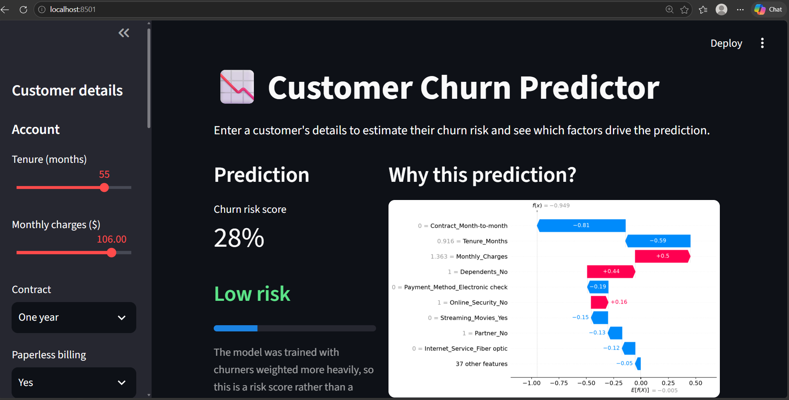
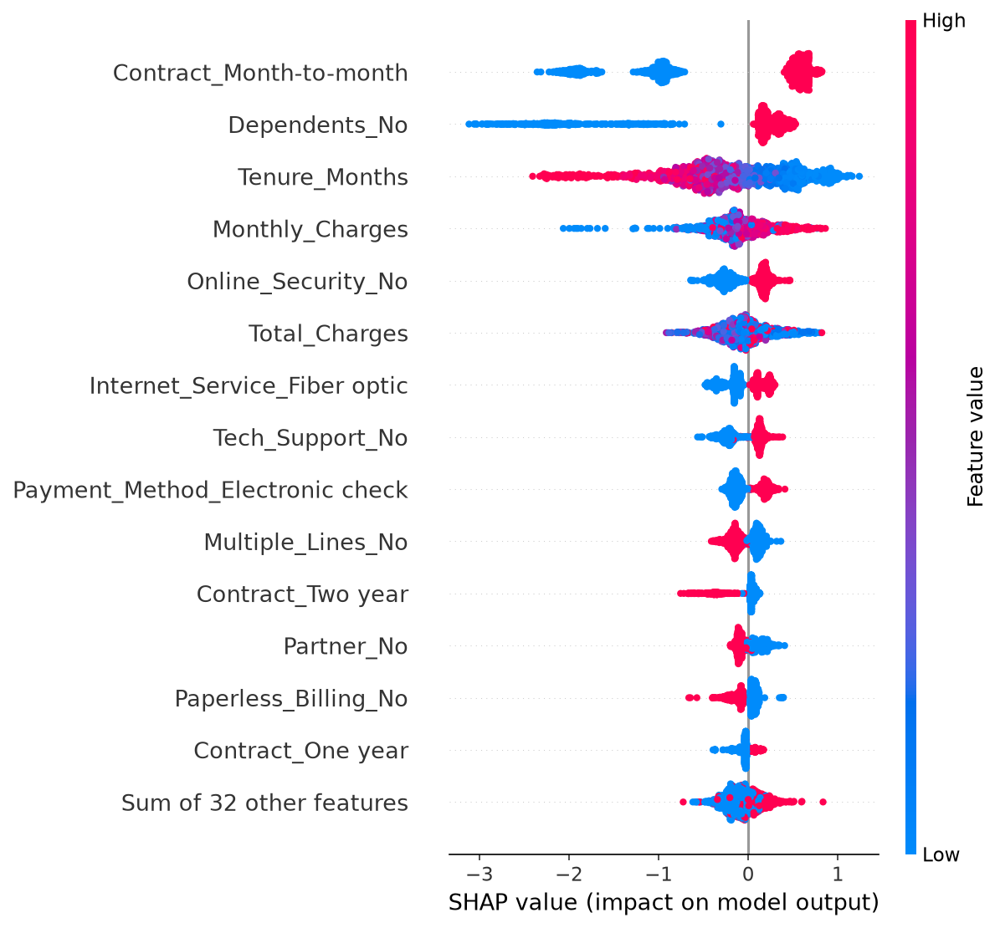

# 📉 Customer Churn Predictor

An end-to-end machine learning project that predicts which telecom customers are likely to cancel, and explains *why* using SHAP.

**🔗 Live demo:** <will add link after deployment>



## Problem

Acquiring a new customer costs far more than keeping an existing one. This project predicts churn risk from account, demographic and service data so a retention team can focus on the customers most likely to leave.

## Dataset

IBM Telco Customer Churn dataset (7,043 customers, 26.5% churn rate).

**Data leakage handling:** the raw file includes `Churn Label`, `Churn Value`, `Churn Score`, `CLTV` and `Churn Reason`. These are only known after a customer has churned (or are derived from churn), so I removed them from the features. Location and ID columns were also dropped.

## Approach

1. **EDA:** examined churn rates across contract type, internet service and payment method.
2. **Preprocessing:** scikit-learn `Pipeline` with scaling for numeric features and one-hot encoding for categorical ones, fit on training data only to avoid leakage.
3. **Modeling:** compared Logistic Regression, Random Forest and XGBoost using 5-fold stratified cross-validation, with class weighting for the imbalanced target.
4. **Explainability:** SHAP values for global feature importance and per-customer explanations.
5. **Deployment:** Streamlit app that shows the risk score and a SHAP waterfall chart for each prediction.

## Results

| Model | ROC-AUC | Precision | Recall | F1 |
|---|---|---|---|---|
| Logistic Regression | 0.849 | 0.510 | 0.781 | 0.617 |
| Random Forest | 0.852 | 0.528 | 0.778 | 0.629 |
| **XGBoost** | 0.851 | 0.521 | 0.786 | 0.627 |

All three models performed similarly (ROC-AUC ≈ 0.85). I chose XGBoost for fast SHAP explanations and a small model file.

I optimized for **recall** (about 79%): for retention, missing a churner usually costs more than contacting a loyal customer. The trade-off is lower precision (about 52%).

## Key insights

- **Contract type:** month-to-month customers churn at 42.7%, versus 2.8% for two-year contracts.
- **Internet service:** fiber optic customers churn at 41.9%, more than double DSL (19.0%).
- **Payment method:** electronic check users churn at 45.3%, versus 15–17% for automatic payments.
- SHAP confirms the same drivers: short tenure, high monthly charges, and no tech support or online security increase risk.



**Suggested actions:** offer discounts for annual contracts, bundle security and support for new fiber customers, and encourage automatic payments.

## Limitations

- Class weighting means the output is a **risk score**, not a calibrated probability.
- The dataset is a static sample with no time dimension, so the model can't capture changing behavior.
- In the app, `Total Charges` is estimated as tenure × monthly charges.

## Run locally

```bash
git clone https://github.com/rkkl1511/churn-predictor.git
cd churn-predictor
python -m venv venv
venv\Scripts\activate        # Mac/Linux: source venv/bin/activate
pip install -r requirements.txt
streamlit run app.py
```

To retrain the model: `python src/train.py`

## Project structure

```
├── app.py    # Streamlit app
├── src/train.py  # Training script
├── notebook     # EDA and modeling 
├── models/   # pipeline + metadata
├── data/         # Cleaned dataset
├── images/ #Plots used in this README
└── requirements.txt
```

## Tech stack

Python, pandas, scikit-learn, XGBoost, SHAP, Streamlit